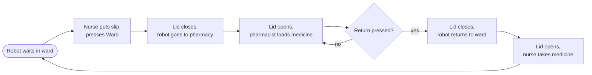
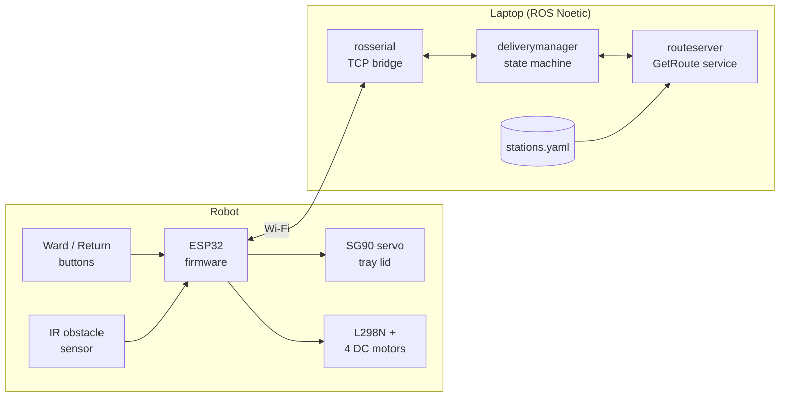

<div align="center">

# MediGuide

**A robot that brings medicine from the hospital pharmacy to the ward, so nurses can stay with their patients.**


</div>

---

## The problem

In many hospitals, nurses walk to the pharmacy several times a day just to collect medicine. Every trip takes them away from their patients, and on busy days the same trip repeats again and again.

## The idea

MediGuide waits in the ward. When medicine is needed:

1. The nurse writes the medicine names on a slip, puts it in the robot's tray and presses the **Ward** button.
2. The tray lid closes and the robot drives to the pharmacy.
3. At the pharmacy the lid opens. The pharmacist reads the slip, puts the medicine in the tray and presses **Return**.
4. The lid closes, the robot drives back to the ward and opens the lid for the nurse.

The lid stays closed while the robot is moving, so the medicine cannot fall out and no one else can take it on the way.



## Features

- **Two-button operation:** no screen and no app, so there is nothing new for hospital staff to learn
- **Secure tray:** an SG90 servo keeps the lid closed while the robot is moving
- **Obstacle stop:** a front IR sensor pauses the robot until the way is clear
- **Wireless:** the ESP32 talks to ROS over Wi-Fi using rosserial, with no cable to the laptop
- **Route in a config file:** the path is a list of simple moves (`F150`, `R90`, …) in YAML, and the way back is generated automatically
- **Full Gazebo simulation:** a hospital world with AMCL localization and move_base path planning
- **Mapping demo:** build the hospital map yourself with gmapping

## System architecture



The same `deliverymanager` node drives both the real robot and the simulation. In **real** mode it sends the route to the ESP32. In **sim** mode it sends goals to `move_base`.

## ROS interface

| Name | Type | Direction | Purpose |
| --- | --- | --- | --- |
| `/robot/button` | `std_msgs/String` | ESP32 → ROS | `ward` or `return` |
| `/robot/go` | `std_msgs/String` | ROS → ESP32 | Route, e.g. `F150,R90,F400,L90,F100,U` |
| `/robot/arrived` | `std_msgs/Bool` | ESP32 → ROS | Route finished |
| `/robot/obstacle` | `std_msgs/Bool` | ESP32 → ROS | Something is in front |
| `/robot/lid` | `std_msgs/Bool` | ROS → ESP32 | `true` = open |
| `/robot/status` | `std_msgs/String` | ROS | What the robot is doing now |
| `/getroute` | `mediguide/GetRoute` | service | Route between `ward` and `pharmacy` |
| `/stations` | `visualization_msgs/MarkerArray` | ROS → RViz | Station labels on the map |

## Repository structure

```
MediGuide/
├── setup.sh                     # installs dependencies and builds the workspace
├── GUIDE.md                     # step-by-step run guide (Roman Urdu)
├── mediguide/                   # ROS package
│   ├── scripts/
│   │   ├── deliverymanager.py   # delivery state machine
│   │   ├── routeserver.py       # GetRoute service
│   │   ├── stationmarkers.py    # RViz markers
│   │   └── nursepanel.py        # keyboard buttons for simulation
│   ├── srv/GetRoute.srv
│   ├── config/                  # stations.yaml, RViz config
│   ├── launch/                  # simulation, mapping and real robot
│   ├── worlds/hospital.world    # Gazebo hospital
│   ├── maps/                    # map used by AMCL
│   └── tools/makehospital.py    # generates the world and map from one wall list
└── esp32/MediGuideESP32/        # ESP32 firmware
```

## Getting started

### Requirements

- Ubuntu 20.04
- ROS Noetic (installed by `setup.sh` if missing)

### Install and build

```bash
git clone https://github.com/Hafsa-Anwar65/MediGuide.git
cd MediGuide
bash setup.sh
```

Open a new terminal after the script finishes.

### Run the simulation

```bash
# Terminal 1: Gazebo hospital, AMCL, move_base and RViz
roslaunch mediguide simulation.launch

# Terminal 2: keyboard version of the two buttons
rosrun mediguide nursepanel.py
```

Press `w` to send the robot to the pharmacy and `r` to bring it back. On slower machines, add `gui:=false` to the first command to run without the Gazebo window.

### Build the map with gmapping

```bash
roslaunch mediguide mapping.launch
rosrun teleop_twist_keyboard teleop_twist_keyboard.py
rosrun map_server map_saver -f ~/hospital_map
```

## Real robot

### Hardware

| Part | Qty |
| --- | --- |
| Car chassis with 4 DC motors and wheels | 1 |
| L298N motor driver | 1 |
| 12V battery and on/off switch | 1 |
| ESP32 dev board | 1 |
| LM2596 buck converter (12V → 5V) | 1 |
| IR obstacle sensor (FC-51) | 1 |
| SG90 servo | 1 |
| Push buttons | 2 |
| Breadboard, jumper wires, small tray | — |

### Wiring

| ESP32 pin | Connects to |
| --- | --- |
| GPIO 14 / 27 / 26 | L298N ENA / IN1 / IN2 (left motors) |
| GPIO 32 / 25 / 33 | L298N ENB / IN3 / IN4 (right motors) |
| GPIO 34 | IR sensor OUT (sensor powered from 3V3) |
| GPIO 13 | Servo signal |
| GPIO 18 / 19 | Ward / Return buttons (other leg to GND) |
| VIN / GND | Buck converter 5V output |

All grounds must be connected together.

### Flash and run

1. Open `esp32/MediGuideESP32/MediGuideESP32.ino` in the Arduino IDE.
2. Install **Rosserial Arduino Library** and **ESP32Servo** from the Library Manager.
3. At the top of the file, set your Wi-Fi name, password and the IP of the ROS computer. Then upload to an **ESP32 Dev Module**.
4. On the ROS computer:
   ```bash
   roslaunch mediguide realrobot.launch
   ```

### Set the route

The path from the ward to the pharmacy lives in `mediguide/config/stations.yaml`:

```yaml
route_to_pharmacy: ["F150", "R90", "F400", "L90", "F100"]
```

| Move | Meaning |
| --- | --- |
| `F150` | forward 150 cm |
| `R90` | turn right 90° |
| `L90` | turn left 90° |

The return route is built automatically: the order is reversed and left and right are swapped. The motors have no encoders, so distance is measured by time. Calibrate `CM_PER_SECOND` and `MS_PER_90_DEG` in the firmware for your robot.

## Limitations and future work

- Without wheel encoders, the real robot moves by time, so its accuracy depends on calibration and battery level. Adding encoders or a 2D LiDAR would let the real robot use the same AMCL and move_base stack as the simulation.
- The current version serves one ward and one pharmacy. More wards can be added as new stations.

## License

Released under the [MIT License](LICENSE).
